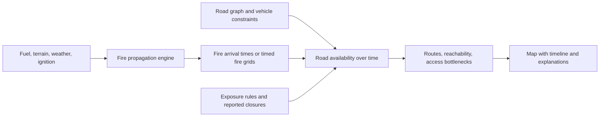

# Fire-Aware Road Access — Idea Assessment

Assessment date: 19 October 2026

## Recommendation

**Pursue this as the main concept: simulate how a spreading wildfire changes road access, then identify which destinations remain reachable, for which vehicles, and for how long under the scenario.**

This is a strong fit for your interest in pathfinding and for the mentors' requirement to implement fire propagation. The simulation becomes essential to the decision: a road that is usable at departure may be affected before a vehicle finishes crossing it.

My recommendation is to reuse an established fire simulator and build the connection between its output and a time-dependent road network yourself. That connection, its explanations, and its evaluation are substantial project work. You do not need to invent fire behaviour equations to make a meaningful contribution.

The water idea remains valuable as a later application: a refill point is useful only if a vehicle can reach it, fill, and return within the modelled access window. Start with road access; add water logistics after the core works.

## The problem worth solving

The central question is:

> Given a simulated fire, a departure time, and a vehicle type, which routes and destinations remain accessible throughout the journey?

For a police or civil-protection planning exercise, useful outputs could include roads expected to become affected, villages losing access from a response base, alternative approaches, and the effect of a manually imposed closure. These are proposed use cases to validate with practitioners, rather than claims about their current workflow.

The strongest version goes beyond colouring roads red when flames reach them. It explains consequences: “This connection is the last modelled access to the village; once it closes, neither of the two response bases can reach it.”

## Why this is a promising direction

| Criterion | Assessment |
| --- | --- |
| Alignment with the mentor requirement | Strong: fire progression directly changes routing decisions. |
| Fit with your interests | Strong: shortest paths, reachability, deadlines, and network bottlenecks are central. |
| Demonstration clarity | Strong: viewers can see a fire advance, a route become infeasible, and an alternative appear. |
| Feasibility | Good for one small area and prepared scenarios; substantially harder as a live operational system. |
| Distinctive contribution | Coupling fire arrival with vehicle traversal and explaining lost access. A map overlay alone is less compelling. |
| Main uncertainty | Preparing compatible fuel/terrain inputs and defining defensible road-exposure assumptions. |

This assessment does not establish research novelty. A literature review would be needed before claiming that wildfire-aware routing itself is new. A well-evaluated local prototype can still be a strong project.

## What you actually need to model

You need two spatial representations that share coordinates and time, plus rules connecting them.

**The landscape** describes where fire can spread. A raster grid is a practical choice: cells carry model-compatible fuel information and terrain attributes, with weather, moisture, and ignition inputs supplied as required by the selected engine. A visual basemap is only the background; it does not contain the information needed to simulate fire.

**The roads** form a directed graph. Nodes represent junctions and endpoints; edges represent road segments with geometry, travel time, direction, and vehicle restrictions.

**The connection** associates each road segment with nearby landscape cells and converts simulated fire arrival into an assumed road-availability deadline.

It helps to distinguish **topography**—elevation, slope, and aspect—from **topology**—which cells or roads connect. You need both. A bridge crossing another road must not automatically create a junction, and a road must not automatically be treated as a fireproof barrier.

## Cell2Fire or an MTT-based model?

These are different kinds of choices: Cell2Fire is a simulator; Minimum Travel Time (MTT) is a fire-growth method used in tools such as FlamMap.

| Approach | Why consider it | Main decision point |
| --- | --- | --- |
| Integrate Cell2Fire | Existing cell-based engine and example landscapes provide a concrete starting point. | Can you run a reproducible example and prepare inputs compatible with its fuel model? |
| Integrate an existing MTT implementation | Fire travel times naturally support road-exposure deadlines. | Verify the particular implementation's licence, platform, automation interface, and export formats. |
| Implement a simplified travel-time propagation model | Strong algorithmic learning opportunity and control over the implementation. | Extra modelling and validation work may consume the time needed for the road-access application. |

The original [Cell2Fire repository](https://github.com/cell2fire/Cell2Fire) describes homogeneous landscape cells with fuel, weather, moisture, and topographic attributes, and elliptical spread driven by a fire-behaviour model. It also labels the software for research use and points to C2FK as a more actively maintained fork. Inspect candidate versions before committing; do not assume different forks have interchangeable fuels or inputs.

The researchers' [Cell2Fire simulation repository](https://github.com/humnetlab/Cell2Fire) provides examples for US, Canadian, and Chilean landscapes with different fuel systems. These are useful integration starting points, but do not establish suitability for Portuguese vegetation.

The [official FlamMap MTT explanation](https://owfflammaphelp62.firenet.gov/Tech_Topics/Tech_MTT.htm) describes searching minimum fire-travel-time paths across the landscape, with weather and fuel moisture held constant over time in that formulation. Treat different wind settings as separate scenarios initially. Time-varying weather needs explicit support from the chosen engine or a carefully defined extension.

**My preferred first step is a short Cell2Fire integration trial using a supplied example.** Continue if you can run it and extract timed spatial output. Choose another implementation if a mentor supplies a working MTT setup with suitable data. Supporting both engines is unnecessary for the first version.

If you build your own propagation model, distinguish it honestly from a validated MTT implementation. Dijkstra over eight neighbouring cells with invented spread costs is a useful prototype, but does not by itself reproduce established MTT behaviour. Directional spread, wind, slope, fuel response, grid bias, and reference comparisons all need attention. Confirm that such an approximation would satisfy the mentors before making it the core submission.

## What to reuse and what to build

Reuse the fire engine, geographic data, and basic graph/geospatial libraries. [OSMnx](https://osmnx.readthedocs.io/en/stable/getting-started.html) can retrieve OpenStreetMap road networks, represent directed connections, attach travel-time estimates, and calculate baseline routes. Its estimated speeds are not emergency-response travel measurements.

Build the scenario preparation, fire-output adapter, road-exposure mapping, time-aware routing logic, and explanation interface. Suggested internal outputs are a fire-arrival layer, road deadlines with reasons, and route results with their assumptions.

A fire-output adapter should preserve units, coordinate system, ignition time, simulation horizon, and run settings. If arrival is inferred from periodic grids, record its time interval rather than implying second-level precision. A cell not reached during a two-hour run is only “not reached within two hours”; it is not permanently unaffected.

For a Portuguese pilot, [DGT open data](https://www.dgterritorio.gov.pt/dados-abertos) is a starting point for landscape datasets. Land-cover classes still need a documented translation to the selected fire model's fuel classes. That translation is a modelling assumption, not an automatic equivalence. Verify terrain coverage and dataset permissions before selecting the final area.

Use one projected coordinate system in metres for intersections and buffers. Align raster extent, resolution, and missing-data handling. Keep enough surrounding landscape and roads that clipping the study boundary does not manufacture isolation or remove valid detours.

## The key technical feature: routes must remain feasible during travel

A route planner that removes only roads affected **now** can still send a vehicle toward a segment that becomes unavailable before it gets there.

For an initial model, assign each edge a closure deadline:

`closure_time(edge) = earliest simulated fire arrival in its exposure buffer - precautionary time margin`

The buffer and margin are configurable scenario assumptions, not validated operational thresholds. Use the complete road geometry, not just its endpoints. Unknown fire data must remain unknown, not silently become unlimited availability.

Then require, for every edge:

`vehicle_exit_time(edge) < closure_time(edge)`

Also enforce vehicle restrictions and reported closures. All times must use the same reference clock. Checking exit time against the earliest exposure anywhere along the edge is conservative and may reject some traversals; splitting long edges improves spatial precision.

Start with fixed travel durations, no congestion, no reopening during the run, and closures that persist. Under those assumptions, an earliest-arrival search can reject an edge when the vehicle would exit too late. Ordinary shortest-path routing on a single snapshot is useful as a baseline, but cannot provide this journey-wide check.

Illustrative scenario only: a segment has a modelled closure deadline of minute 14. A vehicle reaches it at minute 12 and needs four minutes to cross. Reject that route even though the road is still available when the vehicle arrives.

Minimize journey time **among feasible routes**. Do not allow a small numerical risk penalty to make a forbidden segment acceptable. Show the minimum remaining time margin along the chosen route, along with the assumptions used to calculate it.

Arrival alone does not establish mission feasibility. A later extension should include time spent at the destination and a return journey. The MVP should label its result explicitly as an outbound-access calculation.

## Minimum viable scope

Build one planning demonstrator with:

- One small landscape and matching road network.
- One runnable fire engine and a few reproducible ignition/weather scenarios.
- One response base and two or three destinations.
- Two vehicle profiles with a few explicit restrictions.
- A timeline showing simulated fire progression and road availability.
- A comparison of the normal fastest route and the route feasible under the scenario.
- A clear “no feasible route within this scenario” result.

Use supplied simulator data first if local preparation is slow. A synthetic landscape is also useful for controlled tests, provided the actual fire engine runs on it. Move to a small Guimarães-area case once the full pipeline works and compatible inputs are available.

Precomputed runs can make the demonstration responsive, but retain the runnable engine, inputs, and reproduction command. A prerecorded fire animation alone would not demonstrate the required implementation. Clarify whether mentors expect interactive reruns or accept reproducible simulations prepared in advance.

Keep live dispatch integration, full evacuation traffic, automatic police deployment, detailed smoke modelling, and multi-vehicle optimization outside the first version. They each add a separate modelling problem.

## Demonstration story

1. Select a base, destination, vehicle, and departure time. Show the ordinary fastest route.
2. Run or load a reproducible fire scenario and reveal its timeline.
3. Show that the original route reaches one segment after its deadline. Explain exactly where and why it fails.
4. Display a feasible detour, its additional travel time, and its smallest modelled time margin.
5. Move departure later until no route remains feasible under the assumptions.
6. Change the vehicle profile or add a reported closure and show the resulting loss of access.

The memorable result is a changing access window, supported by an inspectable calculation.

## Relationship to the existing ideas

| Existing idea | Role in this direction |
| --- | --- |
| [Water Turnaround](02-water-turnaround.md) | Later, evaluate outbound travel, filling, and return against changing access. The nearest or fastest-filling source may become unusable for the complete cycle. |
| [Before You Arrive](01-before-you-arrive.md) | Supply verified gates, bridge limits, narrow roads, and turnaround constraints that a fire simulation cannot infer. |

Road access is the common foundation. Water logistics adds a focused mission on top of it; local knowledge improves the road graph. Avoid implementing all three product workflows at once.

## Evaluation and limitations

Evaluate the fire and routing components separately. Successfully integrating an established engine does not validate a new local fuel mapping.

| Check | What it establishes |
| --- | --- |
| Reproduce a supplied fire example | The selected engine and output conversion work. |
| Compare controlled flat, sloped, and wind scenarios | Direction, units, and alignment behave plausibly; this is a sanity check, not field validation. |
| Test a road that closes during traversal | The routing logic checks the whole journey. |
| Test a bridge crossing, one-way road, and restricted vehicle | Graph connectivity and access constraints are preserved. |
| Test disconnected destinations and missing inputs | The system returns no-route or unknown results honestly. |
| Vary departure time, weather, resolution, buffer, and margin | Reveals which access conclusions are sensitive to assumptions. |

Report journey-time increase versus the baseline, destinations reachable by departure time, routes rejected for deadline violations, and computation time. Call violations “modelled deadline violations,” not measured injuries or lives saved.

The main modelling limitation is the step from fire exposure to road usability. Smoke, visibility, embers, fallen trees, congestion, and official closures are not determined by a flame-arrival raster alone. Keep reported closures distinct from simulated exposure. A road not reached by modelled fire should be labelled accordingly, rather than simply “safe.”

The [official IFTDSS MTT guidance](https://iftdss.firenet.gov/firenetHelp/help/pageHelp/content/20-models/mtt/aboutmtt.htm) explicitly cautions against tactical use of MTT major paths and explains its constant-condition limitations. Position this project as a scenario-planning and research prototype. Claims about operational routing would require additional validation with the relevant authorities.

## Suggested implementation order

1. **Prove the engine:** reproduce one example and extract spatial progression with timestamps.
2. **Prove the coupling:** attach exposure deadlines to a small road graph and verify the geometry manually.
3. **Prove the routing:** demonstrate a route that becomes invalid during travel, a feasible detour, and a no-route case.
4. **Add the map:** display progression, route comparisons, deadlines, and assumptions clearly.
5. **Ground it locally:** prepare a small Portuguese landscape and review fuel and access assumptions with mentors or practitioners.
6. **Extend only after that:** add a return journey and one water-refill scenario.

The first milestone is decisive. If the fire engine cannot run or its inputs cannot be prepared, resolve that before investing in the interface. If it works, this is a coherent and achievable project with a clear algorithmic centre.

## Proposed project pitch

“We combine wildfire propagation simulation with a road network to show how emergency access changes over time. For a selected vehicle and departure time, the prototype identifies routes that remain feasible under explicit fire-exposure assumptions, explains bottlenecks, and shows when destinations lose access. The same foundation can later support water-refill journeys.”
